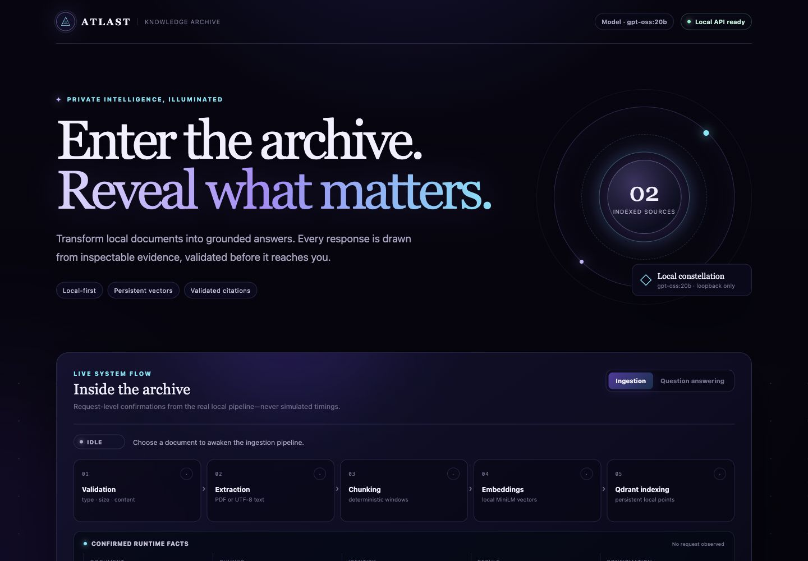
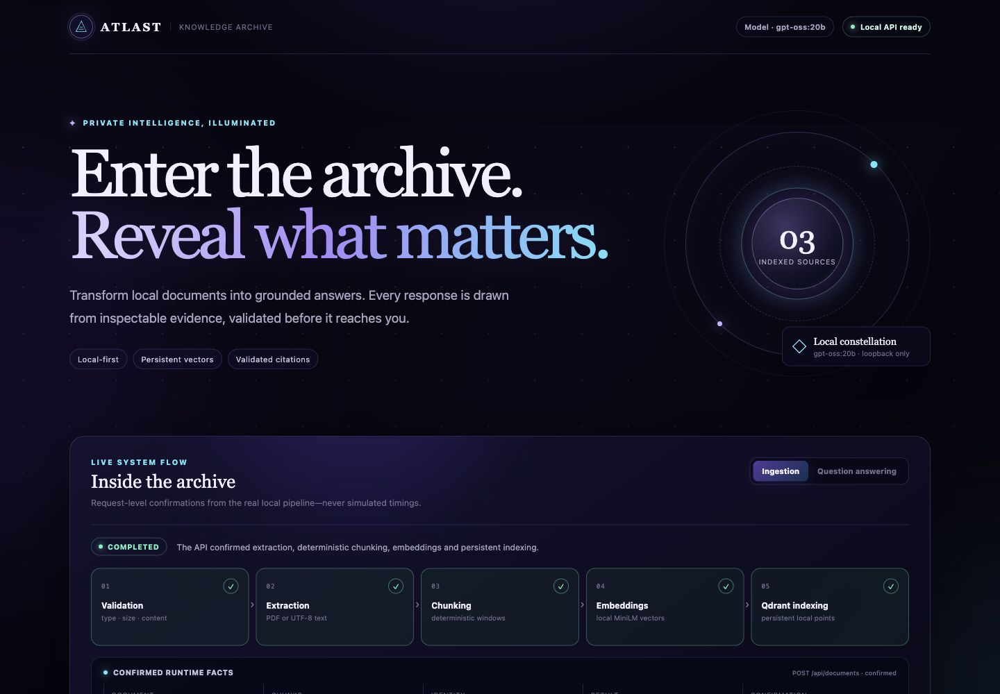
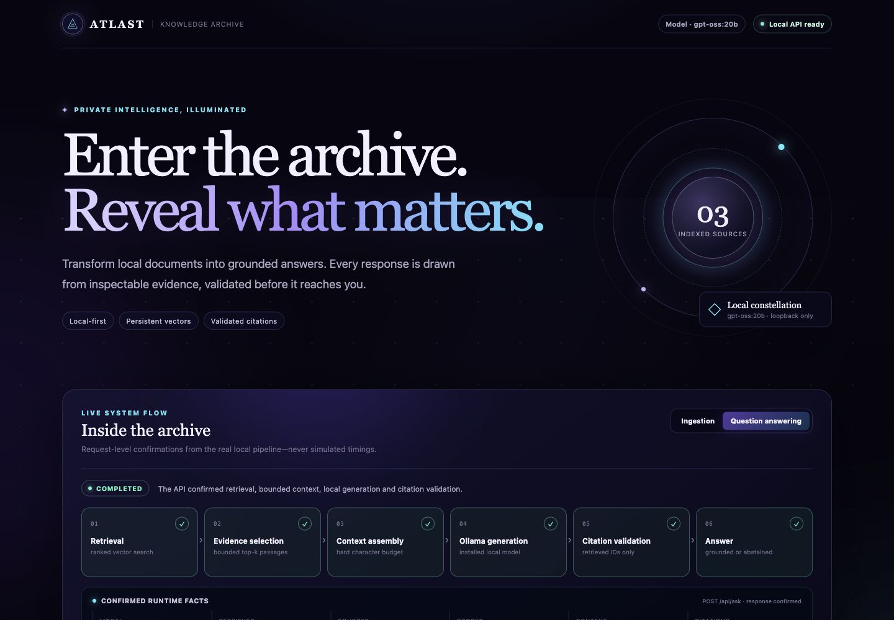
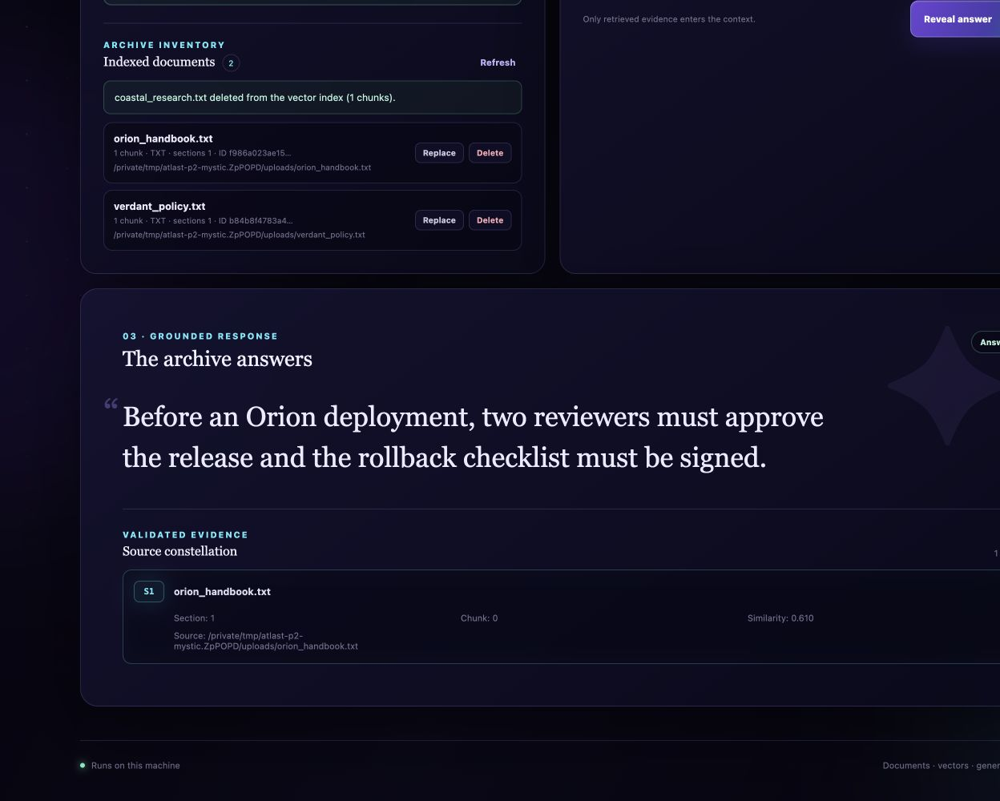
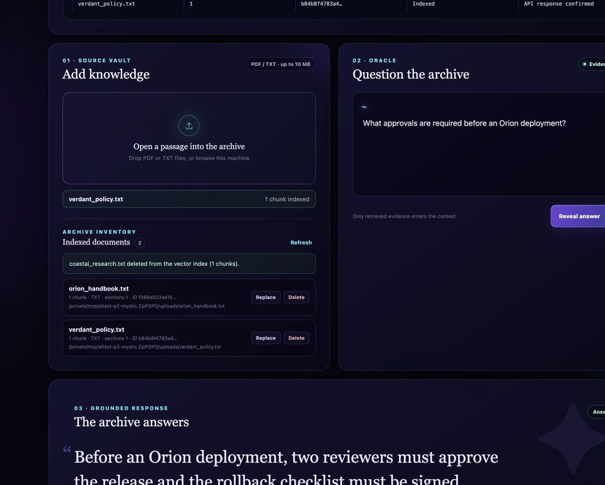
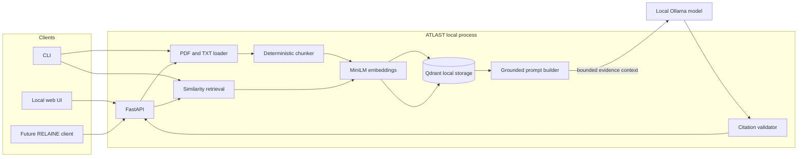

# ATLAST

**Local-first document intelligence with grounded answers and inspectable evidence.**

ATLAST turns PDF and TXT files into a persistent local knowledge base. It combines
deterministic ingestion, lightweight semantic retrieval, and an installed Ollama
model to answer questions with validated citations—without a hosted vector database,
paid inference API, or external document service.

> [!IMPORTANT]
> ATLAST is an authentication-free local MVP. The server binds to `127.0.0.1` and
> must not be exposed directly to the public internet.

## Why ATLAST

- **Keep documents local.** Source files, embeddings, and Qdrant data remain on
  the machine running ATLAST.
- **Trace every answer.** Responses include validated citation IDs, filenames,
  retrieval scores, and page or section metadata.
- **Reproduce the index.** Content-derived IDs, deterministic chunking, pinned
  dependencies, and a packaged benchmark make behavior repeatable.
- **Operate without cloud infrastructure.** The web app, API, vector store,
  embeddings, and generation model all run locally.
- **Manage a changing corpus.** List, replace, and delete individual indexed
  documents without rebuilding the entire collection.

## MVP capabilities

| Area | What is implemented |
| --- | --- |
| Ingestion | UTF-8 TXT and text-extractable PDF uploads with page/section metadata |
| Identity | Stable SHA-256 content IDs and duplicate detection |
| Retrieval | Sentence Transformers embeddings and persistent Qdrant local search |
| Grounded QA | Ollama generation with bounded evidence context and untrusted-source prompting |
| Citations | Model citation IDs validated against retrieved passages before returning |
| Interfaces | CLI, FastAPI endpoints, and a responsive buildless mystical archive interface |
| Live trace | Request-level ingestion and RAG stage confirmations with real runtime metadata |
| Lifecycle | Document listing, isolated deletion, and safe explicit-file replacement |
| Reliability | Synthetic retrieval evaluation plus 40 focused automated tests |

## Product tour

The local interface pairs a midnight-indigo knowledge archive with an observable
pipeline. It shows pending work while a request is active, then marks stages as
completed, skipped, or failed only after the backend confirms the result. Runtime
facts include document identity, chunk count, retrieved sources, similarity
scores, context usage, Ollama model, and validated citation IDs.



| Confirmed ingestion flow | Live grounded RAG trace |
| --- | --- |
|  |  |

| Grounded answer | Document management |
| --- | --- |
|  |  |

## Architecture



Document text is treated as untrusted input. Retrieved source content cannot grant
itself authority, and references not present in the retrieved passage set are
discarded rather than surfaced as citations.

## Technology

- Python 3.10–3.13
- FastAPI and Uvicorn
- Qdrant client in persistent local mode
- Sentence Transformers using `sentence-transformers/all-MiniLM-L6-v2`
- Ollama for local answer generation (`gpt-oss:20b` verified)
- pypdf for PDF extraction
- pytest and synthetic fixtures
- uv with a committed lockfile

## Installation

### Prerequisites

1. Install [`uv`](https://docs.astral.sh/uv/).
2. Install and start [Ollama](https://ollama.com/).
3. Ensure a compatible Ollama model is already installed:

```bash
ollama list
```

ATLAST never downloads an Ollama model automatically. The default embedding model
is downloaded from Hugging Face on first use and then reused from the local cache.

### Reproducible source setup

```bash
git clone <your-atlast-repository-url>
cd <atlast-repository-directory>
uv python install 3.12
uv sync --frozen
```

### Build and install the wheel

```bash
uv build --wheel
uv venv --python 3.12 .release-venv
uv pip install --python .release-venv/bin/python dist/atlast_rag-0.1.0-py3-none-any.whl
.release-venv/bin/atlast --help
```

On Windows, use `.release-venv\Scripts\python.exe` and
`.release-venv\Scripts\atlast.exe` for the final two commands.

## Quick start

### 1. Index and search a document

```bash
uv run --frozen atlast --db .atlast/qdrant ingest examples/sample.txt
uv run --frozen atlast --db .atlast/qdrant search \
  "retrieval quality" --limit 3
```

Re-ingesting identical bytes returns `duplicate` without creating extra points.

### 2. Ask a grounded question

```bash
uv run --frozen atlast --db .atlast/qdrant ask \
  "What makes retrieval quality easier to reproduce?" \
  --ollama-model gpt-oss:20b
```

The response contains an answer, status, validated citation IDs, and structured
source metadata. Configure the local Ollama endpoint with `--ollama-url` or
`ATLAST_OLLAMA_URL`.

### 3. Start the local application

```bash
uv run --frozen atlast --db .atlast/qdrant serve \
  --ollama-model gpt-oss:20b \
  --port 8000
```

Open [http://127.0.0.1:8000](http://127.0.0.1:8000). The interface supports
uploads, corpus listing, grounded questions, citation inspection, replacement,
and deletion. Interactive API documentation is available at
[http://127.0.0.1:8000/api/docs](http://127.0.0.1:8000/api/docs).

Uploads are limited to 10 MB by default. Use `--max-upload-mb` to change the
limit. QA source text is capped at 12,000 characters by default; use
`--max-context-chars` to configure it.

## API workflow

With the local server running:

```bash
# Upload
curl --fail -F file=@examples/sample.txt \
  http://127.0.0.1:8000/api/documents

# List indexed documents
curl --fail http://127.0.0.1:8000/api/documents

# Retrieve passages for another local integration
curl --fail --json '{"query":"retrieval quality","limit":3}' \
  http://127.0.0.1:8000/api/retrieve

# Ask with grounded generation
curl --fail --json \
  '{"question":"What makes retrieval reproducible?","limit":4}' \
  http://127.0.0.1:8000/api/ask
```

Document replacement uses `PUT /api/documents/{document_id}` with a new file;
deletion uses `DELETE /api/documents/{document_id}`. Replacement does not depend
on the original uploaded bytes being available. The retrieval response contract
is kept separate from generated answers for future RELAINE integration.

## Evaluation and verification

Run the packaged synthetic retrieval benchmark:

```bash
uv run --frozen atlast evaluate --k 3
```

Verified A6 result:

| Dataset | Answerable questions | Recall@3 | MRR |
| --- | ---: | ---: | ---: |
| `atlast-synthetic-retrieval-v1` | 6 | **1.0** | **1.0** |

These results measure retrieval on six labeled, answerable questions in a small
synthetic corpus. They **do not establish general RAG accuracy**, answer quality,
or performance on real organizational documents. Both packaged unanswerable
questions still returned retrieval candidates; abstention is handled by the
grounded generation layer rather than a calibrated similarity threshold.

Run the automated suite:

```bash
uv run --frozen pytest
```

The A6 release verification passed all **40 tests** and completed a real
`gpt-oss:20b` upload → ask → cite → replace → retrieve → delete → restart
workflow. Exact environment details and measured outputs are recorded in
[MVP verification](docs/MVP_VERIFICATION.md).

## Repository layout

```text
src/atlast/
├── documents.py        # PDF/TXT extraction and stable identities
├── chunking.py         # deterministic word-window chunking
├── embeddings.py       # Sentence Transformers adapter
├── index.py            # persistent Qdrant index and lifecycle operations
├── qa.py               # grounded prompting, Ollama, citation validation
├── evaluation.py       # Recall@K and MRR benchmark runner
├── web.py              # FastAPI application
├── static/             # dependency-free local web interface
└── eval_data/          # packaged synthetic benchmark
tests/                  # focused unit, API, workflow, and persistence tests
docs/MVP_VERIFICATION.md
```

## Current limitations

- Local-only MVP: no authentication, authorization, TLS, or hosted deployment.
- Only UTF-8 TXT and text-extractable PDFs are supported; scanned PDFs require
  OCR before ingestion.
- Retrieval has no calibrated minimum similarity threshold, so unrelated queries
  can still return low-scoring candidate passages.
- Live flow status is request-level instrumentation, not streamed backend events;
  individual stages are confirmed when the API response completes, without fake
  stage timings.
- Evaluation is synthetic and deliberately small.
- Replacement inserts the new points before deleting the old ones. This avoids
  normal data loss, but a process crash between operations can temporarily leave
  both versions indexed.
- Deleting a document removes its Qdrant points, not retained upload/source files.
- The first embedding use requires network access; Ollama model installation is
  managed separately and can require substantial disk and memory.

## Security and data handling

- Keep the server bound to loopback. Do not expose the unauthenticated API.
- Do not commit `.atlast/`, model weights, environment files, private documents,
  or generated vector databases.
- Treat uploaded documents as sensitive local data and manage retained upload
  files according to your own retention policy.

ATLAST is an MVP intended for local experimentation and controlled internal
evaluation—not an internet-facing production service.
